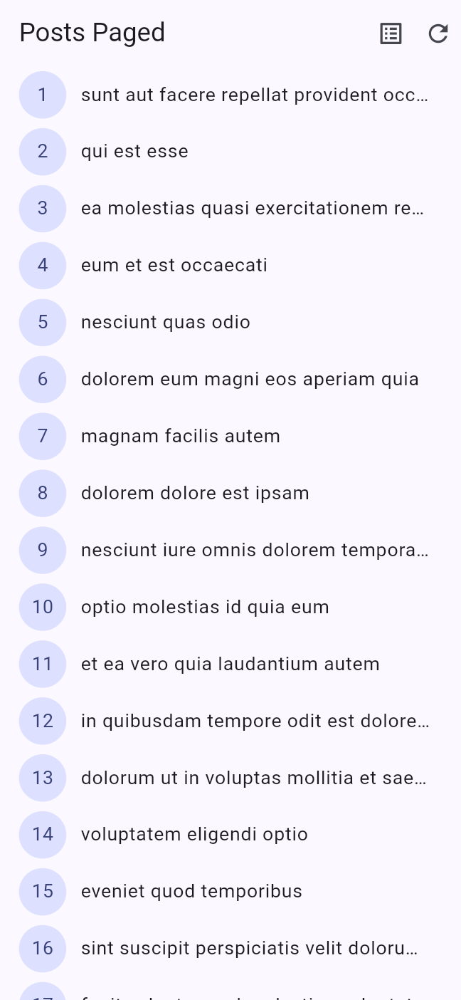
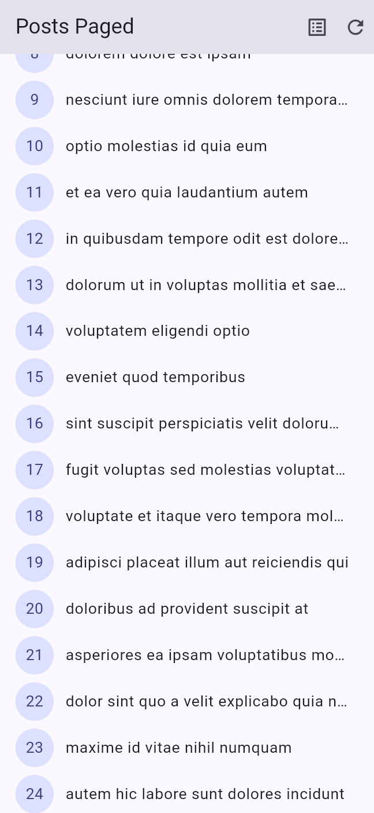
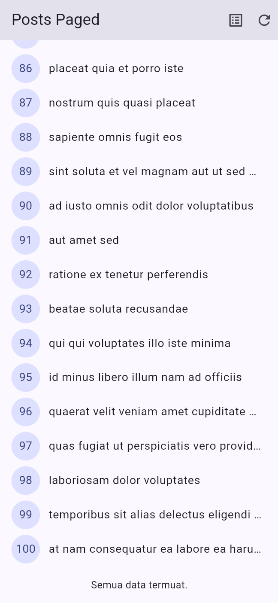
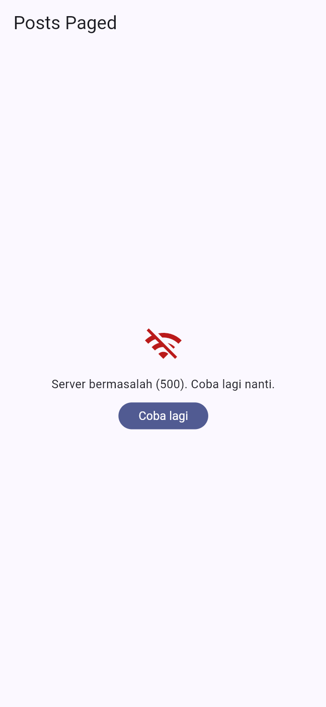
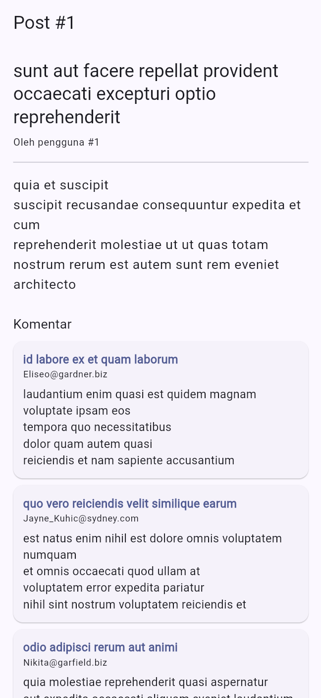
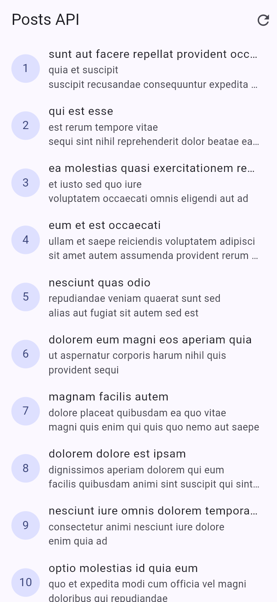

# Minggu 4: Networking & REST API

Laporan tugas praktikum Minggu 4 mata kuliah Pemrograman Mobile, mengikuti
codelab resmi [Minggu 4 — Networking & REST API](https://jti-polinema.github.io/flutter-codelab/04-minggu-4-networking-rest-api/index.html)
(JTI Polinema) serta *Mini Project / Industry Challenge* di dalamnya.

Aplikasi mengambil data dari REST API publik
[JSONPlaceholder](https://jsonplaceholder.typicode.com) (`GET /posts`,
`GET /posts/{id}`, `GET /comments?postId={id}`), memetakannya ke model Dart
yang aman null, lalu menampilkannya lewat **repository + Riverpod** dengan
penanganan state *loading, error, empty,* dan *success*, ditutup dengan
**pagination infinite scroll**.

## Identitas Mahasiswa

- **Nama:** Reny Ambarwati
- **NIM:** 244107020066
- **Kelas:** TI-3F
- **Mata Kuliah:** Pemrograman Mobile

---

## Tujuan Pembelajaran

1. Menjelaskan konsep HTTP, REST API, dan JSON.
2. Memetakan JSON ke model Dart (serialization) dengan aman null.
3. Menerapkan repository pattern dasar sehingga UI tidak memanggil API langsung.
4. Mengonfigurasi Dio (base URL, timeout, interceptor) dan menangani error jaringan.
5. Menampilkan state loading, error, empty, dan success dengan `AsyncValue` + Riverpod.
6. Menerapkan pagination dasar (infinite scroll).

## Stack Teknologi

| Komponen | Versi | Keterangan |
|---|---|---|
| Flutter (Dart) | 3.47.1 (3.13.1) | channel stable |
| `dio` | ^5.11.1 | HTTP client + interceptor |
| `flutter_riverpod` | ^3.4.3 | state management `AsyncValue` |
| `go_router` | ^18.0.2 | routing halaman detail `/post/:id` |
| `flutter_test` | SDK | unit test + widget test |

## Struktur Folder

```
04-week-4-networking-rest-api/
├── week4_api/                      # Project Flutter yang bisa dijalankan
│   ├── lib/
│   │   ├── main.dart               # ProviderScope + GoRouter (/ , /all, /post/:id)
│   │   ├── data/
│   │   │   ├── api_client.dart     # createDio() terpusat (base URL, timeout, logging)
│   │   │   ├── json_utils.dart     # asInt/asString — fromJson aman null & salah tipe
│   │   │   ├── network_errors.dart # friendlyErrorMessage (Refactoring #2)
│   │   │   ├── providers.dart      # dio, repository, PostListNotifier, comments
│   │   │   ├── paged_posts.dart    # PagedPostsState + PagedPostsNotifier (Langkah 8)
│   │   │   ├── models/             # post.dart, comment.dart
│   │   │   └── repositories/       # post_repository.dart, comment_repository.dart
│   │   ├── pages/                  # post_list_page, paged_post_page, post_detail_page
│   │   └── widgets/post_tile.dart  # Refactoring #1
│   ├── test/
│   │   ├── post_test.dart          # 4 test sesuai codelab
│   │   ├── comment_test.dart       # AI Challenge: fromJson + error mapping
│   │   └── widget_test.dart        # PostTile + PagedPostPage dengan fake repository
│   └── tool/
│       ├── mock_api.py             # mock REST API untuk uji loading/empty/error
│       └── mobile_harness.html     # bingkai 390x844 untuk screenshot layout mobile
├── lib/                            # Salinan kode final (dokumentasi portofolio)
├── test/                           # Salinan test final
├── docs/
│   └── ai_challenge.md             # Prompt, keluaran AI, verifikasi, perbaikan
├── screenshots/
└── README.md
```

> Kode yang dapat dijalankan berada di subfolder `week4_api/`. Folder `lib/`
> dan `test/` di root berisi salinan final untuk dokumentasi portofolio,
> mengikuti konvensi minggu-minggu sebelumnya.

## Alur Data

```
UI (ConsumerWidget) --watch--> Provider (AsyncValue)
Provider --panggil--> Repository --pakai--> Dio --HTTP--> REST API
```

UI **tidak pernah** memanggil Dio langsung. Repository adalah satu-satunya
pintu ke API dan membiarkan exception naik, sehingga provider mengubahnya
menjadi `AsyncError` secara otomatis.

---

## Langkah 1 — Model data dengan `fromJson` aman null

`Post` dan `Comment` memakai cast defensif, sehingga field yang hilang,
`null`, atau salah tipe tidak membuat crash `type 'Null' is not a subtype`.

```dart
factory Post.fromJson(Map<String, dynamic> json) => Post(
      userId: asInt(json['userId']),
      id: asInt(json['id']),
      title: asString(json['title']),
      body: asString(json['body']),
    );
```

**Output (test edge case yang saya tambahkan):**

```
+5: test/post_test.dart    : fromJson aman terhadap field yang hilang
+1: test/comment_test.dart : Comment.fromJson aman terhadap field yang hilang
+2: test/comment_test.dart : Comment.fromJson aman terhadap field bertipe salah
```

> **Catatan verifikasi:** pola asli codelab `(json['x'] as num?)` ternyata
> masih crash ketika server mengirim `"postId": "2"` (String) — dibuktikan
> oleh test field bertipe salah. Karena itu saya menambahkan helper
> `asInt`/`asString` di `lib/data/json_utils.dart`.

## Langkah 2 — Konfigurasi Dio terpusat

Seluruh konfigurasi jaringan hidup di `api_client.dart`:

```dart
final dio = Dio(BaseOptions(
  baseUrl: 'https://jsonplaceholder.typicode.com',
  connectTimeout: const Duration(seconds: 10),
  receiveTimeout: const Duration(seconds: 10),
  headers: {'Accept': 'application/json'},
));
dio.interceptors.add(LogInterceptor(requestBody: true, responseBody: false));
```

**Output (log `LogInterceptor` di console browser saat aplikasi berjalan):**

```
*** Request ***
uri: http://127.0.0.1:5051/posts?_page=1&_limit=10
method: GET
responseType: ResponseType.json
followRedirects: true
connectTimeout: 0:00:10.000000
receiveTimeout: 0:00:10.000000
headers:
 Accept: application/json
```

Ketika server dimatikan, interceptor yang sama melaporkan error teknisnya:

```
*** DioException ***:
uri: http://127.0.0.1:5051/posts?_page=1&_limit=10
DioException [connection error]: The connection errored: ...
```

`baseUrl` juga bisa ditimpa lewat `--dart-define` untuk menguji skenario error
tanpa mengubah kode (lihat bagian *Uji Tiga Skenario Error*).

## Langkah 3 — Repository sebagai pintu data

`PostRepository` menyediakan `fetchPosts()`, `fetchPost(id)`, dan
`fetchPostsPage(page, limit)`. Exception sengaja **tidak ditelan** agar
menjadi `AsyncError` di provider.

## Langkah 4 — Provider `AsyncNotifier` + pesan error ramah

`PostListNotifier extends AsyncNotifier<List<Post>>` memanggil repository di
`build()`; Riverpod mengubah exception menjadi `AsyncError`. Retry otomatis
Riverpod 3 dimatikan (`retry: (retryCount, error) => null`) agar error langsung
final dan tidak menggantung saat diuji.

`friendlyErrorMessage()` memetakan `timeout`, `connectionError`, `404`,
`401/403`, dan `5xx` ke bahasa manusia.

**Output (`flutter test -r expanded`, lulus semua):**

```
+6: test/post_test.dart     : friendlyErrorMessage untuk connection error
+2: test/comment_test.dart  : friendlyErrorMessage memetakan 404 ke pesan ramah
+3: test/comment_test.dart  : friendlyErrorMessage memetakan timeout ke pesan ramah
```

## Langkah 5 & 6 — UI loading, error, empty, success

`ProviderScope` membungkus aplikasi; `PostListPage` membaca
`ref.watch(postListProvider)` lalu merender `postsAsync.when(...)`.

| State | Tampilan | Screenshot |
|---|---|---|
| loading | `CircularProgressIndicator` di tengah layar | [`01-loading.png`](screenshots/01-loading.png) |
| error | ikon + pesan ramah + tombol **Coba lagi** (`ref.invalidate`) | [`04-error.png`](screenshots/04-error.png), [`09-server-error.png`](screenshots/09-server-error.png) |
| empty | teks "Belum ada data dari server." | [`05-empty.png`](screenshots/05-empty.png) |
| success | daftar post (`PostTile`) dengan `RefreshIndicator` | [`02-success.png`](screenshots/02-success.png), [`07-all-posts.png`](screenshots/07-all-posts.png) |



## Langkah 7 & 8 — Repository paginated + notifier state halaman

```dart
Future<List<Post>> fetchPostsPage({required int page, int limit = 10}) async {
  final response = await _dio.get<List<dynamic>>(
    '/posts',
    queryParameters: {'_page': page, '_limit': limit},
  );
  ...
}
```

`PagedPostsState` menyimpan `items`, `page`, `isLoadingMore`, `hasMore`, dan
`error` dalam satu objek immutable, sehingga data lama tetap tampil ketika
halaman berikutnya gagal.

**Guard penting:** `if (state.isLoadingMore || !state.hasMore) return;`
mencegah request ganda dan menghentikan request saat data habis.

## Langkah 9 — UI infinite scroll

`ScrollController` memicu `loadNextPage()` saat `extentAfter < 200`
(200px sebelum ujung list), dan item footer menampilkan indikator loading
atau teks "Semua data termuat.".

**Output (pengujian manual di layout mobile 390×844, menemukan bug):**
10 item pertama (10 × ±56px) **muat semua** di layar sehingga
`maxScrollExtent == 0`, `pixels` tidak pernah berubah, dan scroll listener
tidak pernah terpicu — indikator di footer berputar tanpa pernah memuat
halaman berikutnya.

**Perbaikan:** ditambahkan pemeriksaan pasca-frame `_loadIfViewportNotFull()`
yang berjalan setelah `build`, memakai kondisi yang sama
(`_controller.position.extentAfter < 200`) sehingga halaman berikutnya ikut
termuat otomatis ketika daftar belum memenuhi layar. Guard
`isLoadingMore`/`hasMore` tetap berlaku, jadi tidak ada request ganda.

```dart
void _loadIfViewportNotFull() {
  if (!mounted || !_controller.hasClients) return;
  final state = ref.read(pagedPostsProvider);
  if (!state.hasMore || state.isLoadingMore) return;
  if (_controller.position.extentAfter < 200) {
    ref.read(pagedPostsProvider.notifier).loadNextPage();
  }
}
```

**Output:** halaman 1 → 10 termuat otomatis, lalu scroll menambah halaman 2, 3,
… sampai halaman 10 (100 post) dengan indikator "Semua data termuat.".

| Inifinite scroll (halaman 2–3 tampil) | Akhir data (100 post) |
|---|---|
|  |  |

---

## Uji Tiga Skenario Error

| # | Skenario | Cara pengujian | Hasil |
|---|---|---|---|
| 1 | Internet normal | `flutter run` langsung ke `jsonplaceholder.typicode.com` | Daftar post tampil, infinite scroll menambah data, halaman detail + komentar termuat |
| 2 | Koneksi terputus | `flutter run ... --dart-define=API_BASE_URL=http://127.0.0.1:5051` lalu mock server dimatikan (persis seperti mematikan internet/mode pesawat) | "Tidak dapat terhubung ke server. Periksa internet Anda." + tombol **Coba lagi** |
| 3 | `baseUrl` salah / server gagal | Mock server sengaja membalas `500 Internal Server Error` pada `GET /posts?_page=...` | "Server bermasalah (500). Coba lagi nanti." + tombol **Coba lagi** |

Ketiga hasil tersebut diverifikasi juga oleh unit test `friendlyErrorMessage`
untuk `connectionError`, `receiveTimeout`, dan `badResponse` (404/500) tanpa
menyentuh jaringan.




Skenario **empty** diuji dengan mock lokal yang membalas `[]`
(`MOCK_MODE=empty`) pada `GET /posts`:


Skenario **loading** ditangkap saat permintaan `GET /posts` sedang berjalan
(menggunakan mock `MOCK_MODE=delay` bila ingin durasi yang lebih panjang):


---

## Refactoring Challenge

1. **Ekstrak `PostTile`** — widget baris post dipindah ke
   `lib/widgets/post_tile.dart` (parameter `post`, `onTap`, `showBody`), sehingga
   `ListView.builder` pendek dan widget bisa diuji terisolasi.
2. **Pindahkan `friendlyErrorMessage`** ke `lib/data/network_errors.dart`
   sehingga dipakai ulang oleh halaman penuh, halaman paginated, dan halaman detail.
3. **Halaman detail `/post/:id` dengan GoRouter** — menampilkan `title` dan
   `body` lengkap. Bila dibuka dari daftar, `Post` dikirim lewat `extra` sehingga
   tampil tanpa request ulang; bila dibuka langsung (deep link), post diambil
   ulang dari repository lewat `postDetailProvider`.



Halaman daftar penuh (`/all`) untuk perbandingan state success/empty:



---

## AI Prompt Challenge

Dokumentasi lengkap (prompt, keluaran AI, checklist verifikasi, dan perbaikan)
ada di [`docs/ai_challenge.md`](docs/ai_challenge.md).

Ringkasan perbaikan terhadap keluaran AI:

- `Dio` dipusatkan ke `createDio()` (AI membuat Dio baru di dalam repository).
- `fromJson` dibuat aman terhadap tipe salah, bukan hanya `null`.
- Argumen family notifier diperbaiki: `CommentListNotifier(this.postId)`.
- Test ditambah: field hilang, field salah tipe, 404, timeout, provider error.

---

## Tangkapan Layar

Semua screenshot diambil dengan layout mobile 390×844 memakai
`tool/mobile_harness.html` (lihat bagian *Cara Menjalankan*).

| | | |
|---|---|---|
|  **01 — Loading** |  **02 — Success** |  **04 — Error koneksi** |
|  **03 — Pagination (halaman 2–3)** |  **05 — Empty** |  **09 — Server error 500** |
|  **06 — Detail + komentar** |  **08 — Semua data termuat** |  **07 — Daftar penuh `/all`** |

---

## Testing

```sh
cd week4_api
flutter analyze
flutter test
```

**Output `flutter analyze`:**

```
Analyzing week4_api...
No issues found! (ran in 6.0s)
```

**Output `flutter test` (13 test lulus, tanpa HTTP sungguhan):**

```
$ flutter test -r expanded

00:00 +0: week4_api/test/comment_test.dart : Comment.fromJson aman terhadap field yang hilang
00:00 +1: week4_api/test/comment_test.dart : Comment.fromJson aman terhadap field bertipe salah
00:00 +2: week4_api/test/comment_test.dart : friendlyErrorMessage memetakan 404 ke pesan ramah
00:00 +3: week4_api/test/comment_test.dart : friendlyErrorMessage memetakan timeout ke pesan ramah
00:00 +4: week4_api/test/comment_test.dart : provider komentar error dengan repository palsu
00:00 +5: week4_api/test/post_test.dart    : fromJson aman terhadap field yang hilang
00:00 +6: week4_api/test/post_test.dart    : friendlyErrorMessage untuk connection error
00:00 +7: week4_api/test/post_test.dart    : provider sukses dengan repository palsu
00:00 +8: week4_api/test/post_test.dart    : provider error dengan repository palsu
00:00 +9: week4_api/test/widget_test.dart  : PostTile menampilkan id, judul, dan isi post
00:01 +10: week4_api/test/widget_test.dart : PagedPostPage menampilkan data dari repository palsu
00:01 +11: week4_api/test/widget_test.dart : PagedPostPage menampilkan pesan error + tombol retry
00:01 +12: week4_api/test/widget_test.dart : PagedPostsState default: masih loading lebih & punya data
00:01 +13: All tests passed!
```

> Path absolut pada keluaran asli dipotong menjadi `week4_api/test/...`;
> penomoran `+n` adalah penghitung test yang sudah selesai.

Test memakai `FakePostRepository` / `FakeCommentRepository` (override provider),
sehingga memori menjamin tidak ada request HTTP sungguhan di dalam test.

---

## Cara Menjalankan

```sh
cd week4_api
flutter pub get
flutter run            # buka di Chrome/Emerald/edge, atur ukuran ke mobile
```

Aplikasi membuka halaman **Posts Paged** (`/`). Ikon daftar di kanan atas
membuka daftar penuh (`/all`), dan menekan sebuah post membuka detail
(`/post/:id`).

**Uji skenario error/empty/loading tanpa mengubah kode:**

```sh
# 1. mock lokal, lalu matikan mock saat aplikasi sudah jalan → error koneksi
#    (persis seperti mematikan internet / mode pesawat)
$env:MOCK_MODE="mixed"; $env:MOCK_PORT="5051"; python tool\mock_api.py
flutter run -d web-server --web-port 8081 --dart-define=API_BASE_URL=http://127.0.0.1:5051
#    mode "mixed": GET /posts?_page=... membalas 500, GET /posts membalas []

# 2. port tertutup (alternatif) → error koneksi
flutter run -d web-server --web-port 8081 --dart-define=API_BASE_URL=http://127.0.0.1:9

# 3. mock lambat (8 detik) → state loading; mock kosong → state empty
$env:MOCK_MODE="delay"; $env:MOCK_DELAY="8"; python tool\mock_api.py
$env:MOCK_MODE="empty"; python tool\mock_api.py
```

**Mengambil screenshot layout mobile** (dipakai untuk dokumentasi ini):

```sh
python -m http.server 8080 --bind 127.0.0.1     # dari folder week4_api/tool
flutter run -d web-server --web-port 8081       # dari folder week4_api
# lalu buka http://127.0.0.1:8080/mobile_harness.html?src=http://127.0.0.1:8081/
```

`mobile_harness.html` membungkus aplikasi dalam iframe 390×844 sehingga
Flutter web merender layout mobile, bukan layout desktop.

---

## Checklist Verifikasi Mandiri

- [x] UI tidak memanggil Dio langsung; semua akses data lewat repository + provider.
- [x] Empat state tampil benar: loading, error (+ retry), empty, success.
- [x] Pagination: data bertambah saat scroll, tidak ada request ganda, ada indikator akhir data.
- [x] `flutter analyze` tanpa issue dan semua test lulus (13 test).
- [x] Hasil AI diverifikasi dan didokumentasikan pada folder `docs/`.

---

## Refleksi

### 1. Mengapa UI dilarang memanggil Dio langsung?

Karena UI jadi sulit diuji (butuh jaringan sungguhan), sulit mengganti sumber
data, dan pemetaan error tersebar di banyak widget sehingga rawan duplikasi dan
terlewat. Dengan repository, UI hanya bergantung pada provider sehingga bisa
diuji dengan repository palsu dan seluruh kebijakan jaringan berada di satu tempat.

### 2. Kapan pagination client-side cukup, kapan harus server-side?

Client-side cukup bila data kecil dan sudah dimuat sekaligus (mis. < 100 item
yang jarang berubah). Pagination server (`_page`/`_limit`) wajib ketika data
besar: hanya halaman yang dibutuhkan yang dikirim, sehingga konsumsi memori,
pemakaian kuota, dan waktu muat awal tetap hemat.

### 3. Bagaimana exception repository berubah menjadi `AsyncError` tanpa try/catch di setiap widget?

`AsyncNotifier.build` yang melempar exception otomatis ditangkap Riverpod dan
diubah menjadi `AsyncError`. `try/catch` eksplisit tetap dibutuhkan ketika kita
ingin bereaksi secara khusus, misalnya di `refresh()` (menetapkan `AsyncLoading`
lalu memilih mempertahankan data lama saat gagal) atau di `loadNextPage()`
(agregasi state halaman: data lama dipertahankan + error dicatat).

### 4. Bagian mana dari hasil AI yang Anda perbaiki, dan mengapa?

`Dio` dibuat ulang di dalam repository (diganti `createDio()` terpusat),
`fromJson` hanya aman null tapi crash pada tipe salah (ditambah `asInt`/
`asString`), family notifier tidak bisa membaca `postId` (diperbaiki lewat
konstruktor), dan test AI hanya happy path (ditambah 404, timeout, field hilang,
serta provider error dengan repository palsu). Detailnya di
[`docs/ai_challenge.md`](docs/ai_challenge.md).
