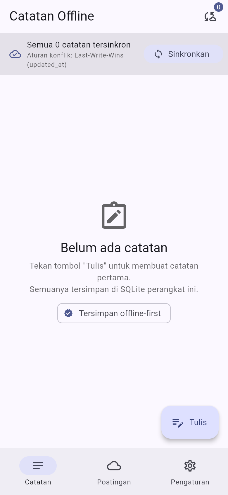
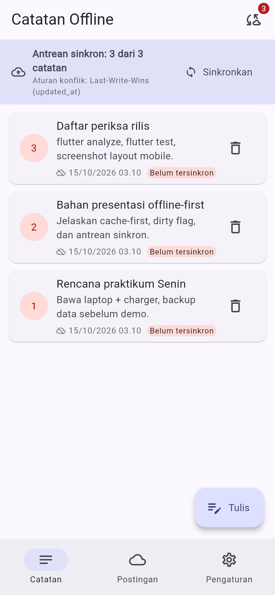
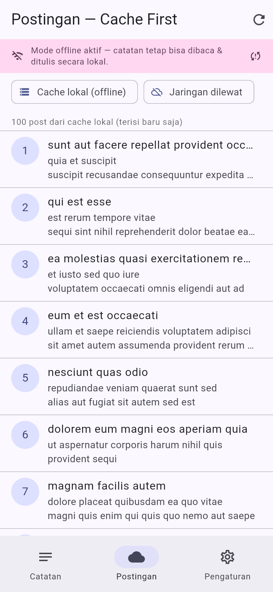
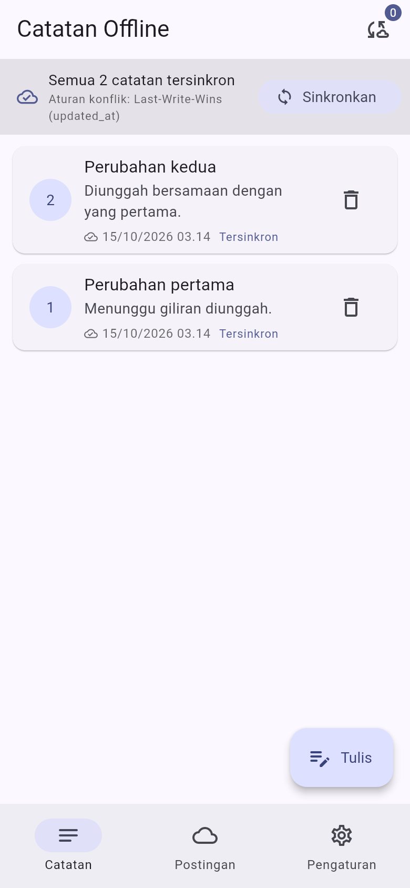
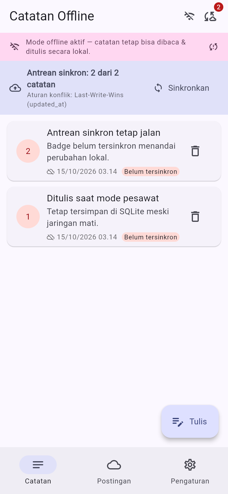
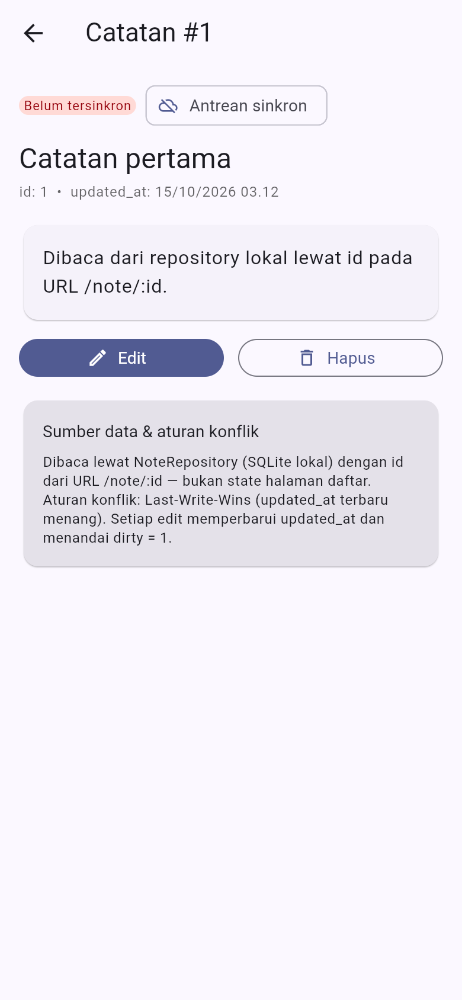
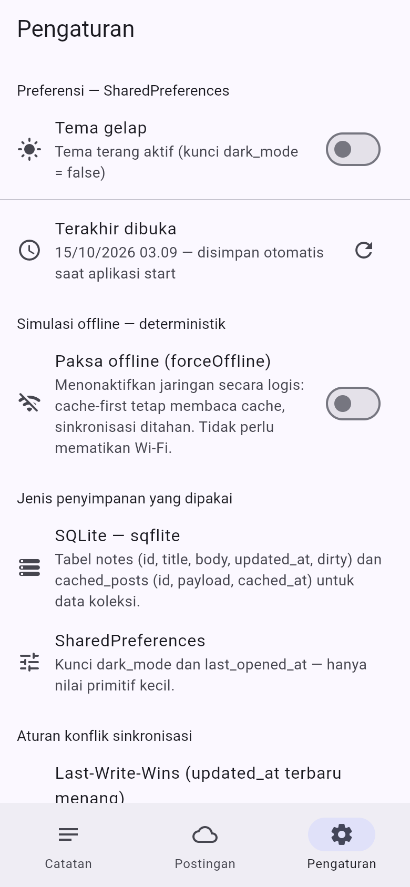
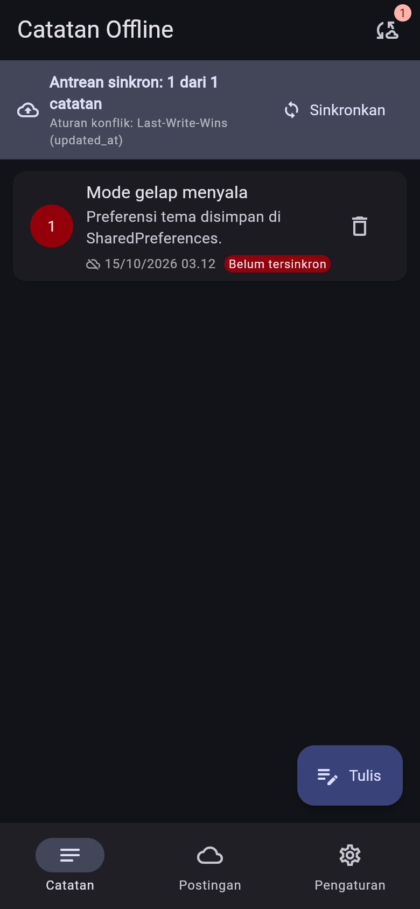

# Minggu 5: Local Storage & Offline-First

## Identitas Mahasiswa

- **Nama:** Reny Ambarwati
- **NIM:** 244107020066
- **Kelas:** TI-3F
- **Mata Kuliah:** Pemrograman Mobile

---

## Tujuan Pembelajaran

1. Menjelaskan perbedaan penyimpanan key-value, relasional, dan NoSQL di perangkat.
2. Menyimpan preferensi sederhana (tema, terakhir dibuka) dengan SharedPreferences.
3. Menerapkan CRUD catatan dengan SQLite (`sqflite`) melalui repository lokal.
4. Menerapkan pola offline-first: cache-first read, dirty flag, dan antrean sinkronisasi.
5. Menampilkan state loading, error, empty, dan success untuk data lokal dengan Riverpod.
6. Menguji repository lokal dengan repository palsu (tanpa database sungguhan).

## Stack Teknologi

| Komponen | Versi | Keterangan |
|---|---|---|
| Flutter (Dart) | 3.47.1 (3.13.1) | channel stable |
| `shared_preferences` | ^2.5.6 | preferensi key-value (tema, terakhir dibuka) |
| `sqflite` | ^2.4.4+2 | SQLite native Android/iOS |
| `sqflite_common_ffi_web` | ^1.2.0 | SQLite-wasm untuk demo web (lihat catatan di Langkah B2) |
| `path` | ^1.9.1 | `getDatabasesPath()` + `join` untuk lokasi database |
| `flutter_riverpod` | ^3.4.3 | state `AsyncValue` + provider |
| `dio` | ^5.11.1 | `GET /posts` (konfigurasi sama dengan Minggu 4) |
| `go_router` | ^18.0.2 | rute halaman detail `/note/:id` |
| `flutter_test` / `flutter_lints` | SDK / ^6.0.0 | unit test + provider test, lint baku |
| `playwright-core` (dev, `tool/`) | ^1.64.1 | pemotret screenshot layout mobile 390×844 |

## Struktur Folder

```
05-week-5-local-storage-offline-first/
├── week5_offline_notes/                # Project Flutter yang bisa dijalankan
│   ├── lib/
│   │   ├── main.dart                   # ProviderScope + GoRouter + tema dari prefs
│   │   ├── data/
│   │   │   ├── prefs.dart              # PrefsRepository (Langkah A1)
│   │   │   ├── providers.dart          # seluruh provider (lihat catatan deviasi)
│   │   │   ├── sync.dart               # cache-first + syncNotes (Refactoring #2)
│   │   │   ├── local/
│   │   │   │   ├── db.dart             # openNotesDb + skema (Langkah B2)
│   │   │   │   └── note.dart           # model Note + flag dirty (Langkah B1)
│   │   │   └── repositories/
│   │   │       └── note_repository.dart# satu-satunya pintu ke SQLite (Langkah B3)
│   │   ├── pages/
│   │   │   ├── home_shell.dart         # NavigationBar: Catatan/Postingan/Pengaturan
│   │   │   ├── notes_page.dart         # daftar + CRUD + badge dirty (Langkah B4)
│   │   │   ├── note_detail_page.dart   # /note/:id (Refactoring #3)
│   │   │   ├── posts_page.dart         # cache-first read (Langkah C1)
│   │   │   └── settings_page.dart      # preferensi + forceOffline (Langkah A2/C3)
│   │   └── widgets/
│   │       ├── note_tile.dart          # Refactoring #1 (+ badge belum tersinkron)
│   │       ├── offline_banner.dart     # banner "Mode offline aktif"
│   │       ├── sync_queue_bar.dart     # bar antrean + tombol Sinkronkan
│   │       └── format.dart             # pemformat waktu Indonesia
│   ├── test/
│   │   ├── note_test.dart              # 6 test: model + provider repository palsu
│   │   └── sync_test.dart              # 7 test: syncNotes + cache-first
│   ├── tool/
│   │   ├── capture.mjs                 # pemotret: satu skenario = satu screenshot
│   │   └── mobile_harness.html         # bingkai 390×844 (opsional, inspeksi manual)
│   └── pubspec.yaml
├── lib/                                # Salinan kode final (dokumentasi portofolio)
├── test/                               # Salinan test final
├── docs/
│   ├── ai_challenge.md                 # prompt, keluaran AI, verifikasi, keputusan
│   └── testing.md                      # output analyze/test + bukti skenario offline
├── screenshots/                        # 8 screenshot layout mobile 390×844
└── README.md
```

### Pemilihan penyimpanan

| Kebutuhan | Pilihan | Alasan singkat |
|---|---|---|
| Tema gelap, waktu terakhir dibuka | `SharedPreferences` | nilai primitif kecil, dibaca sekali saat start |
| Catatan (koleksi, query, urutan, antrean sync) | `SQLite` via `sqflite` | relasi & query parsial (`updated_at DESC`, `WHERE dirty = 1`) |
| Cache 100 post dari API | tabel `cached_posts` di SQLite | payload JSON satu baris per post + `cached_at` |

Perbandingan penuh (vs Hive vs Drift) beserta penolakan alternatif ada di
[`docs/ai_challenge.md`](docs/ai_challenge.md).

---

## Bagian A — SharedPreferences

### Langkah A1 — Repository preferensi

Seluruh akses key-value dipusatkan di `PrefsRepository`
(`week5_offline_notes/lib/data/prefs.dart`), bukan tersebar di widget:

```dart
class PrefsRepository {
  static const _darkModeKey = 'dark_mode';
  static const _lastOpenedKey = 'last_opened_at';

  Future<bool> getDarkMode() async {
    final prefs = await SharedPreferences.getInstance();
    return prefs.getBool(_darkModeKey) ?? false;
  }

  Future<void> setDarkMode(bool value) async { ... }

  Future<void> markOpenedNow() async {
    final prefs = await SharedPreferences.getInstance();
    await prefs.setString(_lastOpenedKey, DateTime.now().toIso8601String());
  }

  Future<String?> getLastOpened() async { ... }
}
```

**Output (halaman Pengaturan setelah aplikasi dibuka —
[`02-pengaturan.png`](screenshots/02-pengaturan.png)):** baris *Terakhir
dibuka* menampilkan waktu dari kunci `last_opened_at` yang baru ditulis
`markOpenedNow()` saat aplikasi start, dan panel preferensi menegaskan
`dark_mode = false` bila tema belum pernah diubah.

### Langkah A2 — Provider tema + halaman pengaturan

```dart
class DarkModeNotifier extends AsyncNotifier<bool> {
  @override
  Future<bool> build() => ref.watch(prefsRepositoryProvider).getDarkMode();

  Future<void> toggle() async {
    final next = !(state.value ?? false);
    state = const AsyncLoading();
    state = await AsyncValue.guard(() async {
      await ref.read(prefsRepositoryProvider).setDarkMode(next);
      return next;
    });
  }
}
```

**Output (tema gelap tersimpan & dipakai ulang —
[`05-tema-gelap.png`](screenshots/05-tema-gelap.png)):** setelah toggle *Tema
gelap* di Pengaturan, halaman Catatan dirender penuh dalam skema gelap.

---

## Bagian B — SQLite (`sqflite`)

### Langkah B1 — Model catatan + flag `dirty`

Field `dirty` adalah jantung antrean sinkronisasi: `true` = perubahan lokal
belum terkirim ke "server".

```dart
class Note {
  final int? id;        // null = catatan baru yang belum masuk database
  final String title;
  final String body;
  final DateTime updatedAt; // urutan daftar + penentu konflik (LWW)
  final bool dirty;         // antrean sinkronisasi offline-first

  Map<String, Object?> toMap() => {
        'id': id,
        'title': title,
        'body': body,
        'updated_at': updatedAt.toIso8601String(),
        'dirty': dirty ? 1 : 0,   // SQLite tidak punya tipe bool
      };

  factory Note.fromMap(Map<String, Object?> map) { ... } // aman null
}
```

### Langkah B2 — Pembuka database

Satu fungsi pembuka untuk seluruh repository (`lib/data/local/db.dart`), dengan
dua tabel: `notes` (CRUD + antrean sync) dan `cached_posts` (cache-first read).

```dart
Future<Database> openNotesDb() async {
  if (kIsWeb) {
    // Demo web: SQLite-wasm, persisten di IndexedDB.
    databaseFactory = databaseFactoryFfiWeb;
    return openDatabase(notesDbName, version: 1, onCreate: _onCreate);
  }
  final dir = await getDatabasesPath();
  return openDatabase(p.join(dir, notesDbName), version: 1, onCreate: _onCreate);
}
```

### Langkah B3 — Repository sebagai satu-satunya pintu data

`NoteRepository` mengekspos seluruh operasi yang dibutuhkan UI dan
sinkronisasi. Pengurutan daftar dan pembersihan antrean ada di tingkat query,
bukan di widget:

```dart
Future<List<Note>> fetchNotes() async {
  final db = await _openDb();
  final rows = await db.query('notes', orderBy: 'updated_at DESC');
  return rows.map(Note.fromMap).toList();
}

Future<int> countDirty() async {
  final rows = await db.rawQuery(
      'SELECT COUNT(*) AS c FROM notes WHERE dirty = 1');
  return ((rows.first['c'] as num?)?.toInt() ?? 0);
}

/// Dipanggil hanya setelah "server" menjawab sukses.
Future<void> markAllSynced() async {
  final db = await _openDb();
  await db.update('notes', {'dirty': 0}, where: 'dirty = 1');
}
```


### Langkah B4 — Halaman catatan offline (CRUD + badge)

Halaman Catatan (`notes_page.dart`) menampilkan: daftar `NoteTile` (dengan
badge "Belum tersinkron" bila `dirty`), baris ringkasan antrean
`SyncQueueBar` + tombol **Sinkronkan**, badge jumlah kotor di app bar, tombol
FAB **Tulis** untuk menambah catatan lewat dialog, dan tarik-turun untuk
refresh. Halaman tetap berfungsi penuh saat offline karena semua data lokal.

**Output:**

| State empty (database bersih) | Tiga catatan, semua "Belum tersinkron" |
|---|---|
|  |  |
---

## Bagian C — Offline-first

### Langkah C1 — Cache-first read untuk data API

```dart
final cached = (await source.readRows()).map(CachedPost.fromRow).toList();

if (forceOffline) {
  return cached;                     // offline: cache tetap tampil
}
if (cached.isEmpty && awaitFirstLoad) {
  return downloadPosts(source, fetchRemote); // kunjungan pertama: loading jujur
}
final fresh = isCacheFresh(cached, maxAge: maxAge);
if (!fresh && onBackgroundRefresh != null) {
  onBackgroundRefresh(downloadPosts(source, fetchRemote)); // refresh di background
}
return cached;
```



### Langkah C2 — Sinkronisasi catatan kotor (dirty)

```dart
Future<int> syncNotes(NoteRepository repo, {bool offline = false}) async {
  final dirtyCount = await repo.countDirty();
  if (offline) {
    debugPrint('[sync] mode offline → $dirtyCount catatan tetap antre');
    return 0;                        // antrean ditahan, UI tidak diblokir
  }
  if (dirtyCount == 0) return 0;
  await Future.delayed(const Duration(seconds: 1)); // simulasi upload
  await repo.markAllSynced();        // hanya dipanggil saat "sukses"
  return dirtyCount;
}
```

**Output:**

| Sebelum: antrean 3, badge kotor per baris | Sesudah: "Semua 2 catatan tersinkron", badge 0 |
|---|---|
|  |  |


### Langkah C3 — Simulasi offline yang deterministik

| Langkah modul | Hasil observasi | Bukti |
|---|---|---|
| Matikan koneksi, buka aplikasi | Catatan tetap tampil, badge dirty akurat, banner "Mode offline aktif" | [`06-offline.png`](screenshots/06-offline.png) |
| Tulis/hapus catatan saat offline | Berhasil penuh (semua operasi lokal); catatan baru otomatis `dirty = 1` | log `[notes] tambah #1 "Ditulis saat mode pesawat" → dirty = 1` |
| Nyalakan koneksi, jalankan `syncNotes` | Badge kembali 0, daftar menampilkan "Tersinkron" | [`07-sinkron-selesai.png`](screenshots/07-sinkron-selesai.png) |
| `syncNotes` dijalankan saat offline | Antrean ditahan (`0` diunggah), `markAllSynced` tidak dipanggil | test `syncNotes saat offline menahan antrean` → log `[sync] mode offline → 1 catatan tetap antre` |



---

## Refactoring Challenge

1. **Ekstrak `NoteTile`** (`lib/widgets/note_tile.dart`) — baris catatan
   menjadi widget tersendiri yang menampilkan judul, cuplikan isi, waktu
   `updated_at`, dan **badge "Belum tersinkron"** bila `dirty == true`
   (lihat [`01-empty.png`](screenshots/01-empty.png) dan
   [`03-tiga-dirty.png`](screenshots/03-tiga-dirty.png)).
2. **Pindahkan logika cache & sinkronisasi ke `lib/data/sync.dart`** —
   `NoteRepository` kembali fokus pada CRUD lokal; `sync.dart` berisi
   `loadPostsCacheFirst`, `downloadPosts`, `syncNotes`, `conflictRule`, dan
   `SyncReport`. Logika cache juga dipisah dari SQLite lewat abstraksi
   `PostCacheSource`, sehingga bisa diuji dengan sumber in-memory.
3. **Halaman detail `/note/:id` dengan GoRouter** — `noteDetailProvider`
   membaca catatan dari **repository lokal** berdasarkan `id` pada URL, bukan
   dari state halaman daftar, jadi deep link pun tetap menampilkan data yang
   benar.



## AI Prompt Challenge

Dokumentasi lengkap ada di
[`docs/ai_challenge.md`](docs/ai_challenge.md).

Ringkasan hasil:

- **Keputusan:** SharedPreferences untuk preferensi + `sqflite` (SQLite) untuk
  catatan & cache — kombinasi yang sama dengan rekomendasi AI, tetapi
  diverifikasi sendiri melalui kriteria modul (query, relasi, reaktivitas,
  type-safety, boilerplate, testing).
- **Ditolak dari keluaran AI:** saran menyimpan daftar catatan di
  SharedPreferences sebagai JSON tunggal (rapuh untuk query parsial & antrean
  sync), serta klaim "real-time" tanpa dukungan stream sungguhan.
- **Drift ditunda:** bagus untuk query kompleks + stream, tetapi boilerplate
  migrasi dan kurva belajar belum sepadan untuk skala aplikasi ini; Hive
  ditolak sebagai penyimpanan utama karena tidak memberi query SQL
  (`WHERE dirty = 1`, `ORDER BY updated_at DESC`) yang menjadi tulang punggung
  fitur minggu ini.
- **Skema yang diusulkan AI diverifikasi** mendukung antrean sync (kolom
  `dirty` + `updated_at`), bukan CRUD polos.

---

Rincian per test ada
di [`docs/testing.md`](docs/testing.md).

---

## Tangkapan Layar

| # | Skenario | Yang dibuktikan |
|---|---|---|
| 01 | `empty` | State empty + antrean 0 saat database kosong |
| 02 | `pengaturan` | Kunci SharedPreferences: `last_opened_at` terisi, `dark_mode = false` |
| 03 | `tiga-dirty` | 3 catatan masuk SQLite, badge kotor per baris + badge jumlah |
| 04 | `detail` | `/note/:id` membaca dari repository lokal |
| 05 | `tema-gelap` | Tema dari SharedPreferences dipakai ulang |
| 06 | `offline` | `forceOffline`: banner offline + catatan lokal + badge akurat |
| 07 | `sinkron-selesai` | `syncNotes` mengosongkan antrean (badge 3 → 0) |
| 08 | `cache-posts` | Cache-first `GET /posts` tampil tanpa jaringan |

| | | |
|---|---|---|
|  **01 — Empty** |  **02 — Pengaturan** |  **03 — Tiga catatan kotor** |
|  **04 — Detail `/note/:id`** |  **05 — Tema gelap** |  **06 — Mode offline** |
|  **07 — Sesudah sinkron** |  **08 — Cache-first posts** | |

---

## Pemenuhan Mini Project / Industry Challenge

| Butir modul | Pemenuhan | Bukti |
|---|---|---|
| 1. Preferensi tema + terakhir dibuka | `PrefsRepository` + `DarkModeNotifier` + `LastOpenedNotifier` | [`02-pengaturan.png`](screenshots/02-pengaturan.png), [`05-tema-gelap.png`](screenshots/05-tema-gelap.png) |
| 2. CRUD SQLite via repository + Riverpod, urut `updated_at DESC` | `NoteRepository.fetchNotes(orderBy: 'updated_at DESC')` + `NotesNotifier` | [`01-empty.png`](screenshots/01-empty.png), [`03-tiga-dirty.png`](screenshots/03-tiga-dirty.png), [`04-detail.png`](screenshots/04-detail.png) |
| 3. Offline-first: cache-first, dirty flag + `syncNotes`, aturan konflik eksplisit | `lib/data/sync.dart` (`loadPostsCacheFirst`, `syncNotes`, `conflictRule`) | [`08-cache-posts.png`](screenshots/08-cache-posts.png), [`07-sinkron-selesai.png`](screenshots/07-sinkron-selesai.png), test `aturan konflik last-write-wins` |
| 4. Bukti mode pesawat: screenshot offline + badge sebelum/sesudah sync | Skenario `offline`, `tiga-dirty`, `sinkron-selesai` | [`06-offline.png`](screenshots/06-offline.png) + [`03`](screenshots/03-tiga-dirty.png) → [`07`](screenshots/07-sinkron-selesai.png) |
| 5. Minimal 2 test lulus | 13 test (6 model/provider + 7 sinkronisasi/cache) | [`docs/testing.md`](docs/testing.md) |
| 6. AI Challenge terdokumentasi | prompt, output awal AI, tabel perbandingan, checklist verifikasi, keputusan final | [`docs/ai_challenge.md`](docs/ai_challenge.md) |
| 7. Push ke repo portfolio dengan struktur `lib/`, `test/`, `docs/`, `README.md`, `screenshots/` | Struktur folder root sesuai permintaan | daftar folder di atas |

---

## Refleksi

### 1. Mengapa daftar catatan tidak boleh disimpan di SharedPreferences?

SharedPreferences pada dasarnya map key-value berbasis XML/plist untuk nilai
primitif. Menyimpan daftar catatan sebagai satu string JSON di sana membuat
**query parsial mustahil dilakukan di tingkat penyimpanan** — menguruti
`updated_at DESC`, menghitung `WHERE dirty = 1`, atau mengubah satu catatan
berarti memuat, mem-parse, memodifikasi, dan menulis ulang seluruh string.
Selain lambat dan rawan korup parsial (tulis gagal di tengah → seluruh data
hilang), pendekatan itu juga memaksa semua data terbaca ke memori sekaligus.
Karena itu koleksi selalu masuk database, sedangkan SharedPreferences hanya
untuk nilai kecil seperti `dark_mode`.

### 2. Kapan cache-first cukup, kapan butuh strategi lain?

Cache-first cocok untuk data yang **boleh sedikit basi** dan bersifat
*replaceable* — daftar post, katalog, profil. UI tampil seketika dari cache,
selisih kebaruannya diperbarui diam-diam di background. Network-first (jaringan
dulu, cache sebagai cadangan) dibutuhkan ketika **kebaruan lebih penting
daripada kecepatan tampil**, misalnya harga tiket, saldo, atau kurs: di sini
UI harus menunggu jawaban server, dan cache hanya dipakai ketika jaringan
gagal. Pertimbangan lain: cache-first berisiko menampilkan harga lama beberapa
detik, sedangkan network-first membuat pengalaman *loading* terasa di setiap
kunjungan.

### 3. Bagaimana dirty flag berubah menjadi antrean sync tanpa memblokir UI? Kapan tabel outbox diperlukan?

Di aplikasi ini, `dirty = 1` pada baris catatan *adalah* antrean: `countDirty`
membaca ukurannya, `syncNotes` memprosesnya, dan `markAllSynced` membersihkannya
— semuanya berjalan di background task Riverpod sehingga UI tetap responsif
(bahkan `syncNotes` sengaja menghasilkan laporan `SyncReport` untuk snackbar,
bukan menghalangi gesture). Batasnya terlihat ketika sinkronisasi menjadi
**bermacam-macam**: menghapus catatan (butuh operasi `delete` di server),
mengunggah lampiran, atau menerapkan *retry backoff* per item — flag tunggal
`dirty` tidak punya ruang untuk menyimpan jenis operasi, urutan antar-item,
atau jumlah percobaan. Saat itulah tabel **outbox** terpisah (satu baris per
operasi dengan `type`, `payload`, `attempts`, `status`) menjadi perlu.

### 4. Bagian mana dari rekomendasi AI yang Anda tolak, dan mengapa?

Dua hal. Pertama, keluaran awal AI menyebut SharedPreferences layak untuk
"daftar catatan kecil" — saya tolak karena alasan butir 1 di atas: keputusannya
bukan soal ukuran, melainkan soal kebutuhan query parsial dan ketahanan
transaksi yang hanya dimiliki database. Kedua, AI mengklaim Drift "real-time
gratis" lewat stream; saya verifikasi bahwa klaim itu hanya benar jika seluruh
bacaan memang memakai `watch` — sedangkan aplikasi ini memilih model
`AsyncValue` eksplisit (baca sekali → tampilkan → refresh saat ada pemicu),
sehingga manfaat stream tidak terpakai dan boilerplate Drift (migrasi, codegen)
akan menjadi biaya tanpa guna. Rincian perbandingan dan verifikasinya ada di
[`docs/ai_challenge.md`](docs/ai_challenge.md).

---
