# Minggu 6: Authentication, Security & FCM

## Identitas Mahasiswa

- **Nama:** Reny Ambarwati
- **NIM:** 244107020066
- **Kelas:** TI-3F
- **Mata Kuliah:** Pemrograman Mobile

---

## Tujuan Pembelajaran

1. Menjelaskan alur autentikasi (Firebase Auth / JWT / OAuth) dan perbedaan
   *ID token* vs *access token* vs *refresh token*.
2. Menyimpan token secara aman dengan *secure storage* serta menerapkan
   *token refresh* otomatis.
3. Menjelaskan arsitektur FCM: app server → Firebase → perangkat.
4. Meminta *notification permission* dan mengelola *token lifecycle*
   (`getToken`, `onTokenRefresh`).
5. Membedakan *notification payload* vs *data payload* serta perilakunya pada
   state *foreground*, *background*, dan *terminated*.
6. Menangani klik notifikasi (deep link dengan GoRouter) dan *topic messaging*.
7. Menerapkan prinsip keamanan dasar: tidak menyimpan secret di kode, tidak
   mencetak token ke log.

## Stack Teknologi

| Komponen | Versi | Keterangan |
|---|---|---|
| Flutter (Dart) | 3.47.1 (3.13.1) | channel stable |
| `flutter_riverpod` | ^3.4.3 | state management (`AsyncValue`) |
| `go_router` | ^18.1.0 | routing + guard + deep link |
| `dio` | ^5.11.1 | HTTP client + interceptor refresh 401 |
| `flutter_secure_storage` | ^11.2.0 | Keychain / Keystore untuk token |
| `firebase_core` | ^4.15.0 | inisialisasi Firebase |
| `firebase_messaging` | ^16.7.0 | FCM: permission, token, pesan |
| `flutter_local_notifications` | ^22.3.2 | banner manual saat foreground |
| `flutter_test` | SDK | unit test tanpa Firebase sungguhan |


## Struktur Folder

```
06-week-6-authentication-security-fcm/
├── lib/                             # Project Flutter (bisa dijalankan)
│   ├── main.dart                    # bootstrap + GoRouter guard + listener auth
│   ├── routes.dart                  # Refactoring #1: konstanta rute terpusat
│   ├── firebase_options.dart        # placeholder (diisi flutterfire configure)
│   ├── data/
│   │   ├── token_store.dart         # Langkah 1: satu-satunya pintu token
│   │   ├── auth_repository.dart     # Langkah 2: mock auth + titik ganti Firebase
│   │   ├── api_client.dart          # Langkah 3: interceptor 401 → refresh → retry
│   │   ├── api_errors.dart          # Refactoring #3: DioException → pesan ramah
│   │   ├── device_api.dart          # kontrak POST /devices (+MockDeviceApi)
│   │   └── demo_campus_api.dart     # server tiruan GET /me (401 sekali lalu 200)
│   ├── providers/
│   │   ├── auth_provider.dart       # Langkah 4: authStateProvider (AsyncNotifier)
│   │   └── push_provider.dart       # PushState: permission, token, log event
│   ├── messaging/
│   │   ├── push_service.dart        # kontrak PushService + PushMessage + model
│   │   ├── demo_push_service.dart   # simulator (aktif saat Firebase belum ada)
│   │   ├── fcm_push_service.dart    # implementasi FCM asli
│   │   ├── fcm_push_adapter.dart    # adapter FCM + deteksi ketersediaan Firebase
│   │   ├── background_handler.dart  # top-level @pragma('vm:entry-point')
│   │   ├── bootstrap.dart           # pilih FCM asli vs simulator
│   │   └── route_parser.dart        # Refactoring #2: routeFromMessage (murni)
│   └── pages/                       # login_page, home_page, announcement_page
├── test/
│   ├── auth_push_test.dart          # 23 test: parsing route, sesi/refresh, dsb.
│   ├── router_guard_test.dart       # allow-list rute deep link
│   └── widget_test.dart             # konsistensi konstanta rute
├── tool/
│   ├── capture.mjs                  # Playwright: screenshot layout mobile 390x844
│   ├── serve.mjs                    # server statis build/web (tanpa dependensi)
│   ├── mobile_harness.html          # bingkai 390x844 untuk pratinjau manual
│   └── package.json                 # playwright-core
├── docs/
│   ├── ai_challenge.md              # prompt, output AI, perbaikan manual
│   └── device_endpoint.md           # kontrak POST /devices
├── screenshots/                     # 14 bukti screenshot (390x844)
└── README.md
```

## Arsitektur & Alur

### Alur autentikasi

```
Login --> access (15 mnt) + refresh (7 hari) tersimpan aman (Secure Storage)
Request API --header Bearer access--> 401 expired?
                                          | Ya
                                          v
                              tarik refresh --> access baru
                                          | 
                                          v
                                ulangi request SEKALI
Refresh ikut kedaluwarsa --> clear() --> paksa login ulang (/login)
```

### Alur FCM

```
App Server (backend) --kirim ke--> Firebase Cloud Messaging
FCM --push--> Perangkat Android / iOS
Aplikasi --daftar token--> Backend (POST /devices, simpan token per user)
```

### Pemetaan tiga app state

| State | Arti | Handler yang bekerja | Bukti |
|---|---|---|---|
| Foreground | Aplikasi terbuka | `onMessage` → tampil manual | `08`, `09` |
| Background | Aplikasi diminimize | banner sistem + `onMessageOpenedApp` | `10` |
| Terminated | Aplikasi dimatikan | `getInitialMessage()` saat dibuka | `11` |

---

## Langkah 1 — Penyimpanan token yang aman

Seluruh token hanya keluar-masuk lewat `lib/data/token_store.dart`
(`flutter_secure_storage` → Keychain/Keystore), **bukan** `SharedPreferences`.

```dart
class TokenStore {
  TokenStore({FlutterSecureStorage? storage})
      : _storage = storage ?? const FlutterSecureStorage();
  ...
  Future<void> save({required String access, required String refresh}) async {
    await _storage.write(key: _accessKey, value: access);
    await _storage.write(key: _refreshKey, value: refresh);
  }
}
```

## Langkah 2 — Repository auth (mock siap diganti Firebase Auth)

`AuthRepository.login()` memvalidasi bentuk email & panjang sandi, lalu
menghasilkan sepasang token simulasi; `refresh()` menukar refresh token lama
dengan access token baru. Method `login()` adalah **titik ganti tunggal** ke
`FirebaseAuth.instance.signInWithEmailAndPassword` / `signInWithGoogle`.

```dart
Future<AuthSession> login({required String email, required String password}) async {
  await Future<void>.delayed(loginLatency);
  if (!email.contains('@') || password.length < 6) {
    throw const AuthException('Email atau kata sandi tidak valid');
  }
  ...
}
```

## Langkah 3 — Dio dengan refresh otomatis saat 401

```dart
onError: (e, handler) async {
  final alreadyRetried = e.requestOptions.extra['X-Auth-Retry'] == true;
  if (e.response?.statusCode == 401 && !alreadyRetried) { ... }
}
```
## Langkah 4 — Provider auth + guard route

`authStateProvider` (`AsyncNotifier<bool>`) membaca status login dari token.
GoRouter di `main.dart` memakai `redirect` yang mengarahkan belum-login ke
`/login` selamanya, plus `ref.listenManual` → `router.refresh()` agar guard
berjalan ulang setiap status auth berubah (login/logout/refresh gagal).

```dart
redirect: (context, state) {
  final loggedIn = ref.read(authStateProvider).value ?? false;
  final goingLogin = state.matchedLocation == AppRoutes.login;
  if (!loggedIn && !goingLogin) return AppRoutes.login;
  if (loggedIn && goingLogin) return AppRoutes.home;
  return null;
},
```

## Langkah 5 — Permission & token lifecycle

`requestPermission()` (Android 13+/iOS wajib runtime), lalu `getToken()` →
kirim ke backend `POST /devices`. Listener `onTokenRefresh` **wajib** ada:
tanpa itu backend menyimpan token basi setelah reinstall/rotasi keamanan.


## Langkah 6 — Notification vs data payload & tiga app state
```json
{
  "message": {
    "topic": "pengumuman-kampus",
    "notification": {
      "title": "Jadwal kuliah berubah",
      "body": "Kelas Mobile pindah ke Ruang A2 jam 13.00"
    },
    "data": { "route": "/pengumuman/3", "id": "3" }
  }
}
```

## Langkah 7 — Background handler & topic messaging

Handler background harus **fungsi top-level** dengan
`@pragma('vm:entry-point')` karena berjalan di isolate terpisah — bukan method
kelas, dan tidak boleh mengakses `BuildContext`/Riverpod
(`messaging/background_handler.dart`).

Topik dipakai untuk **broadcast**, token perangkat untuk **pesan personal**:

**Topik aktif (screenshot `06`):** switch ON → `Berlangganan broadcast kampus`
**Topik nonaktif (screenshot `07`):** log memperlihatkan urutan
`subscribeToTopic` → `unsubscribeFromTopic("pengumuman-kampus")`

---

## Refactoring Challenge

| # | Tantangan modul | Implementasi | Keuntungan |
|---|---|---|---|
| 1 | Pindahkan semua string rute ke `lib/routes.dart` | `AppRoutes.login/home/announcement(id)`, `isAllowed()`, `isAnnouncement()` | Deep link FCM & GoRouter memakai konstanta yang sama |
| 2 | Ekstrak parsing `RemoteMessage` → route ke fungsi murni | `routeFromMessage()`, `announcementIdFromMessage()`, `hasNotificationPayload()` di `route_parser.dart` | Bisa diunit-test tanpa Firebase |
| 3 | Pemetaan `DioException` → pesan ramah ke `api_errors.dart` | `apiErrorMessage(e)` menangani 401, timeout, offline, dsb. | UI hanya menerima pesan, bukan exception mentah |

---

## Daftar Screenshot

Seluruh screenshot diambil pada layout mobile **390 × 844**.

| # | Berkas | Isi |
|---|---|---|
| 1 |  | Halaman login (guard route: belum login selalu ke `/login`) |
| 2 | 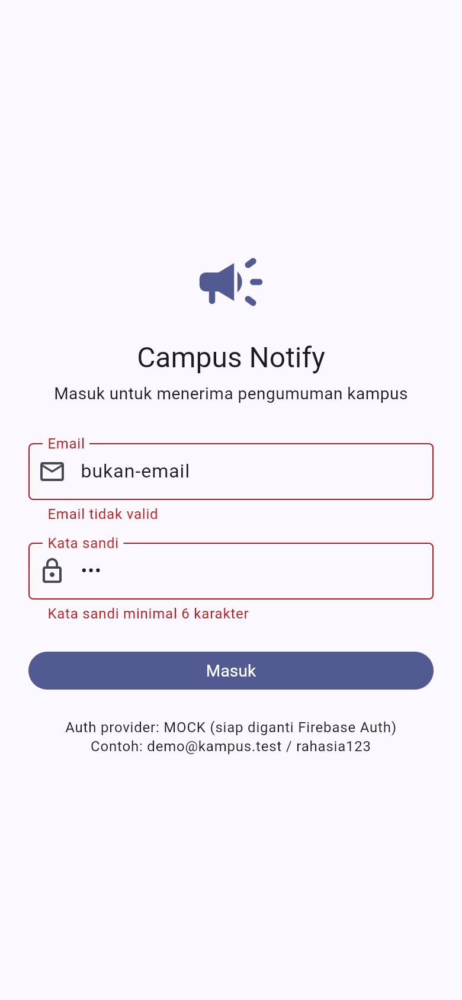 | Validasi form: email tidak valid + sandi < 6 karakter |
| 3 | 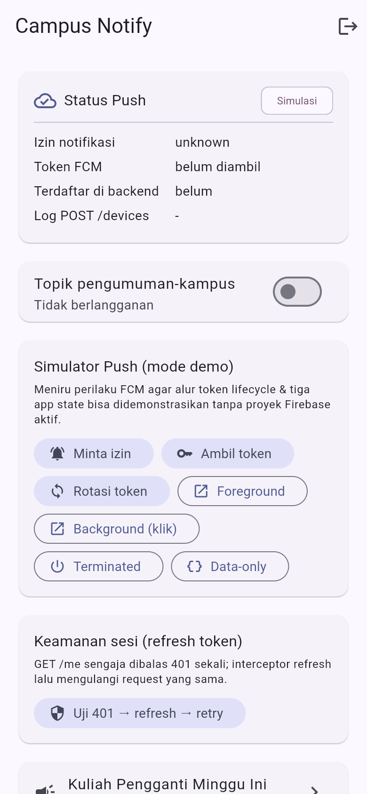 | Beranda setelah login: kartu status, topik, simulator |
| 4 | 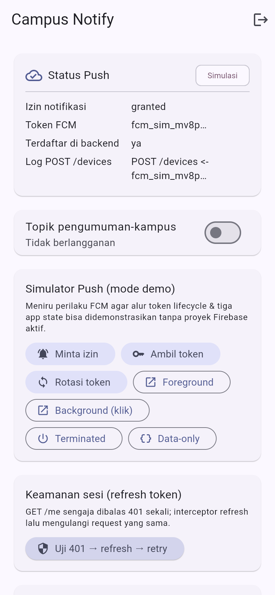 | Permission granted + token **terpotong** + `POST /devices` |
| 5 | 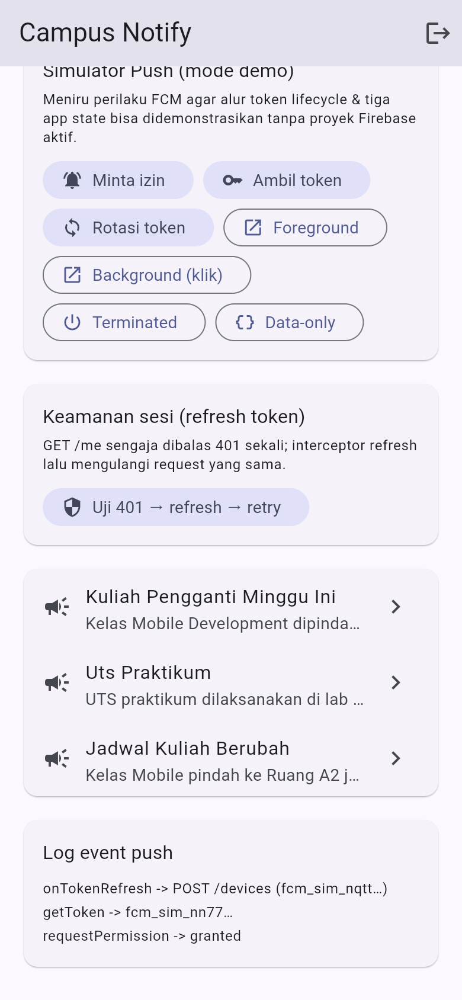 | `onTokenRefresh` → kirim ulang token baru ke backend |
| 6 | 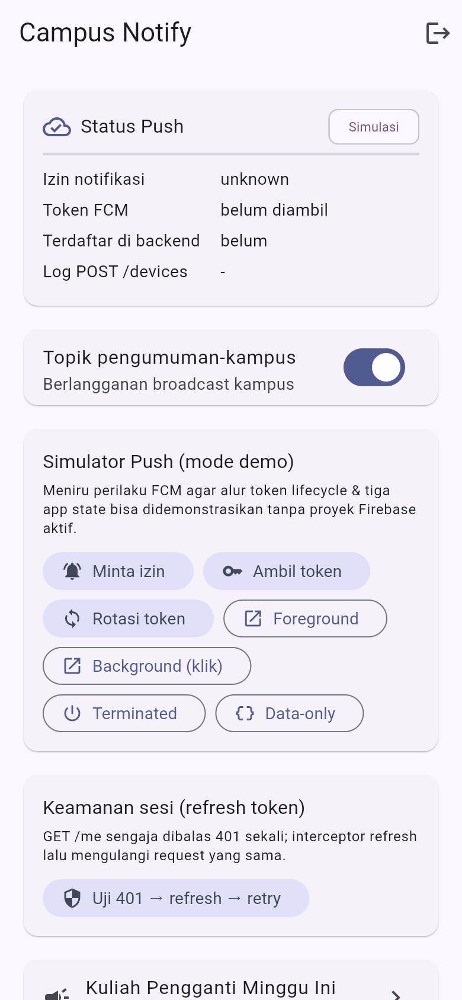 | Topik `pengumuman-kampus` aktif (berlangganan) |
| 7 | 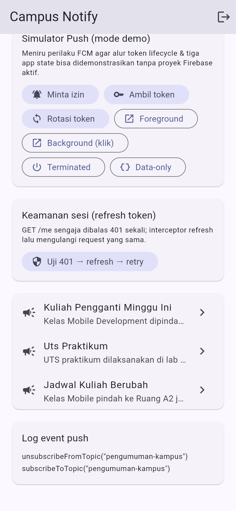 | Log `subscribeToTopic` → `unsubscribeFromTopic` |
| 8 | 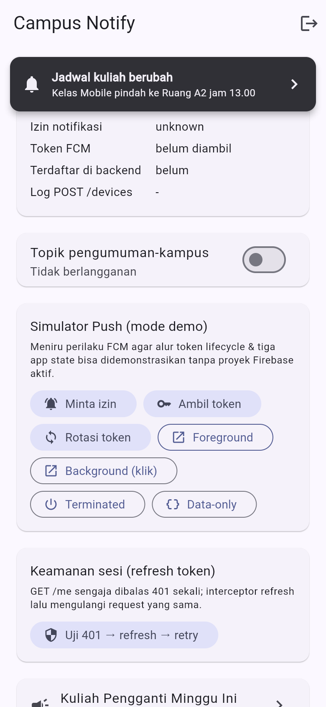 | Banner in-app muncul saat foreground |
| 9 | 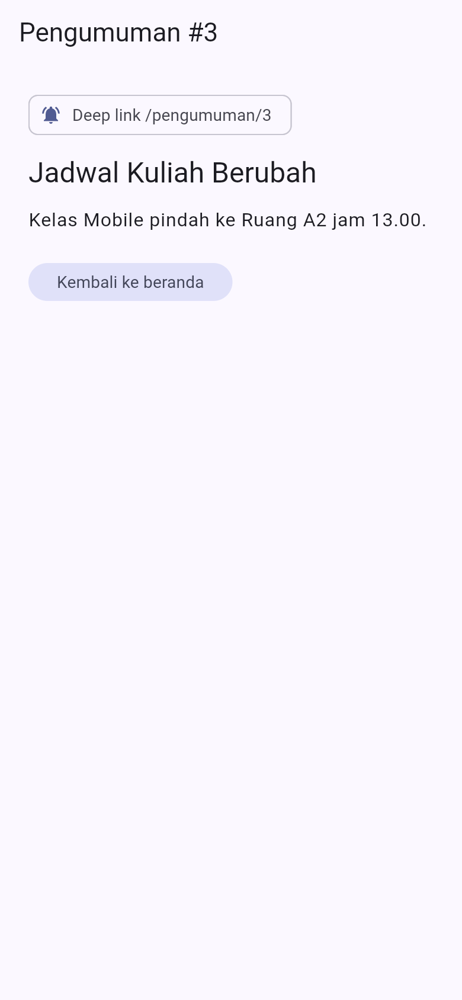 | Klik banner → `/pengumuman/3` |
| 10 | 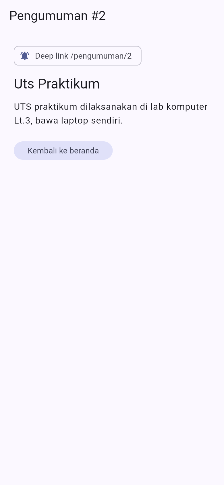 | Klik banner background → `/pengumuman/2` |
| 11 | 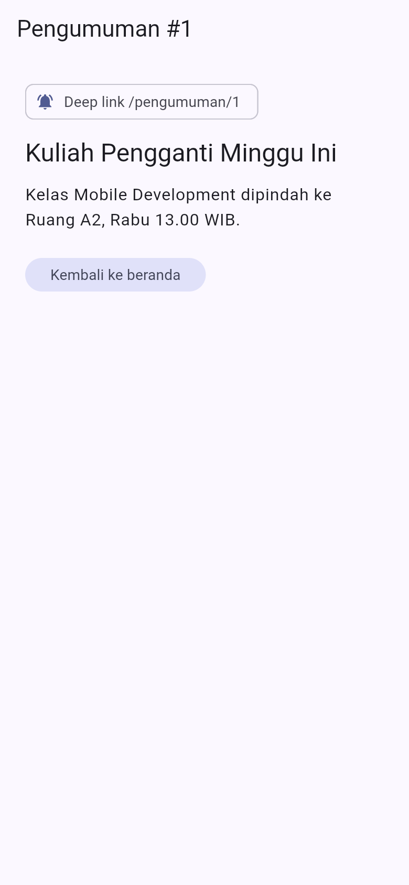 | `getInitialMessage()` → `/pengumuman/1` |
| 12 | 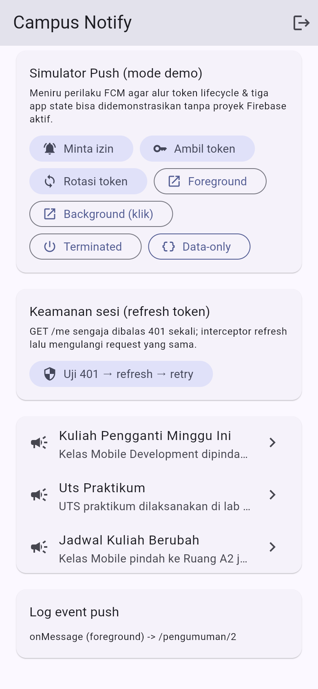 | Pesan hanya-data: **tanpa banner**, hanya log |
| 13 | 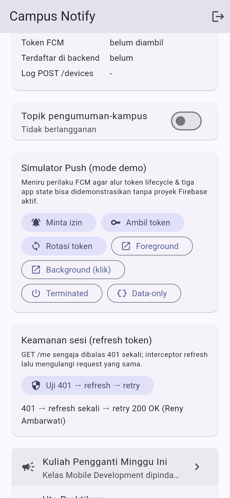 | `401 → refresh sekali → retry 200 OK` |
| 14 | 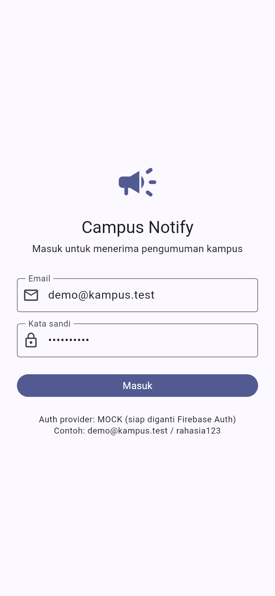 | Setelah `Keluar`, guard mengembalikan ke `/login` |

---

## Refleksi

### 1. Mengapa refresh token tidak boleh disimpan di `SharedPreferences`?

`SharedPreferences` menyimpan data dalam berkas XML **tanpa enkripsi**, mudah
dibaca lewat *rooted device*, *backup* (ADB/Google Backup), atau file explorer.
Refresh token adalah "tiket panjang" — bocor berarti penyerang bisa mempertahankan
akses selama token itu hidup, bahkan setelah pengguna mengganti sandi. Karena itu
refresh token hanya hidup di Keychain/Keystore (`flutter_secure_storage`) dan
dikirim lewat **body POST HTTPS**, bukan query URL yang tercatat di log server.

### 2. Apa yang rusak bila `onTokenRefresh` diabaikan satu semester?

FCM memutakhirkan registration token saat aplikasi di-reinstall, data dihapus,
perangkat dipulihkan, atau rotasi keamanan berkala terjadi. Tanpa listener ini,
backend tetap menyimpan **token basi** sehingga pengiriman notifikasi perlahan
menjadi sunyi tanpa error yang terlihat — mahasiswa berhenti menerima pengumuman
kampus tanpa sebab yang jelas. Karena itu listener wajib ada dan **mengirim ke
backend**, bukan sekadar mencetak ke log.

### 3. Kapan memakai topik, kapan memakai token perangkat?

Topik untuk **broadcast satu-per-satu banyak penerima** yang sama: "Kuliah
pengganti Jumat", "Libur nasional", pengumuman satu angkatan/UKM — backend cukup
sekali kirim ke topik. Token perangkat untuk **pesan personal** yang tidak boleh
dilihat orang lain: nilai akhir, tagihan UKT, presensi, atau pesan dari dosen
PA — karena topik bersifat publik bagi siapa pun yang Subscribe.

### 4. Bagian mana dari draf AI yang saya tolak/perbaiki?

Empat perbaikan utama: (a) **server tiruan 401** dipindah dari interceptor
bertumpuk ke `HttpClientAdapter` karena interceptor auth tidak menerima 401;
(b) **banner foreground** dibatasi hanya untuk payload ber-`notification`, agar
pesan hanya-data tidak ikut menampilkan banner; (c) **allow-list rute** ditambahkan
ke `routeFromMessage` agar payload pihak ketiga tidak bisa mengarahkan pengguna
sembarangan; (d) **API `flutter_local_notifications` v22** menuntut parameter
named (`settings:`, `id:`) sehingga draf awal tidak kompilasi. Detail dan
prompt lengkap di [`docs/ai_challenge.md`](docs/ai_challenge.md).

---

